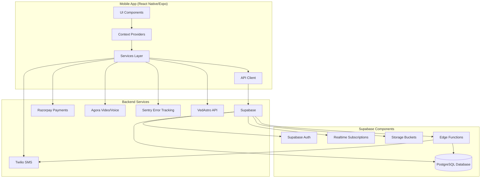

# Design Document: AstroFusion Production Readiness

## Overview

This design document outlines the technical architecture for making the AstroFusion astrology application production-ready. The application is a React Native/Expo mobile app built with TypeScript that provides kundli generation, astrologer consultations, horoscopes, and AI-powered astrology features.

### Current State

The application has foundational infrastructure in place:
- **Supabase Client**: Configured with secure storage for auth tokens
- **AuthContext**: Phone-based authentication with OTP support (hybrid Supabase Auth + database fallback)
- **Logger Service**: Structured logging that routes to Sentry in production
- **ErrorBoundary**: React error boundary component for graceful error handling
- **RateLimiter**: Client-side rate limiting with AsyncStorage
- **Database Types**: TypeScript types for all database tables

### Production Readiness Goals

The design addresses three phases:
1. **Phase 1 (Make It Usable)**: Core functionality - database, authentication, listings, chat, payments
2. **Phase 2 (Make It Reliable)**: Error handling, logging, monitoring, notifications
3. **Phase 3 (Make It Complete)**: Video calls, cloud sync, E2E tests, staging environment

---

## Architecture

### System Architecture



### Technology Stack

**Frontend:**
- React Native 0.74+ with Expo SDK 51+
- TypeScript 5.x
- Expo Router for navigation
- React Context for state management
- Lucide React Native for icons

**Backend:**
- Supabase (PostgreSQL 15+, Auth, Realtime, Storage, Edge Functions)
- Twilio for SMS OTP delivery
- Razorpay for payment processing
- Agora for video/voice calls
- Sentry for error tracking and performance monitoring

**Development:**
- Jest for unit testing
- Detox for E2E testing
- ESLint + Prettier for code quality
- GitHub Actions for CI/CD

### Component Architecture

```
app/
├── (tabs)/              # Tab-based navigation screens
├── admin/               # Admin dashboard
├── astrologer/          # Astrologer profile screens
├── booking/             # Consultation booking
├── call/                # Voice/video call screens
├── chat/                # Chat screens
└── ...

components/
├── admin/               # Admin-specific components
├── ai-chat/             # AI chat components
├── chat/                # Chat UI components
├── home/                # Home screen components
├── kundli/              # Kundli display components
├── onboarding/          # Onboarding flow
├── panchang/            # Panchang components
├── shared/              # Shared UI components
└── ui/                  # Base UI components

contexts/
├── AuthContext.tsx      # Authentication state
├── WalletContext.tsx    # Wallet balance state
└── NotificationContext.tsx  # Push notification state

services/
├── logger.ts            # Structured logging
├── error-reporting.ts   # Sentry integration
├── rate-limiter.ts      # Rate limiting
├── auth-service.ts      # Authentication logic
├── wallet-service.ts    # Wallet operations
├── chat-service.ts      # Real-time chat
├── payment-service.ts   # Razorpay integration
├── notification-service.ts  # Push notifications
├── agora-service.ts     # Video/voice calls
└── kundli-service.ts    # Kundli calculations

lib/
├── supabase.ts          # Supabase client
├── database.types.ts    # Database TypeScript types
└── api-client.ts        # HTTP client wrapper

utils/
├── secure-storage.ts    # Secure storage wrapper
├── crypto.ts            # Cryptographic utilities
└── validation.ts        # Input validation
```

---

## Database Schema

### Schema Overview

The database consists of 16 tables organized into functional domains:

**User Management:**
- `users` - User profiles and authentication
- `user_devices` - Device binding for security

**Astrology Services:**
- `kundlis` - Birth chart data
- `kundli_matches` - Compatibility analysis
- `horoscopes` - Daily/weekly/monthly predictions

**Consultations:**
- `astrologers` - Astrologer profiles
- `astrologer_availability` - Scheduling
- `consultations` - Consultation sessions
- `chat_messages` - Real-time messages
- `reviews` - User reviews

**Commerce:**
- `wallet_transactions` - Wallet operations
- `subscriptions` - Subscription plans
- `orders` - Product orders
- `order_items` - Order line items
- `products` - Spiritual products

**System:**
- `notifications` - Push notifications
- `referrals` - Referral tracking

### SQL Migration

